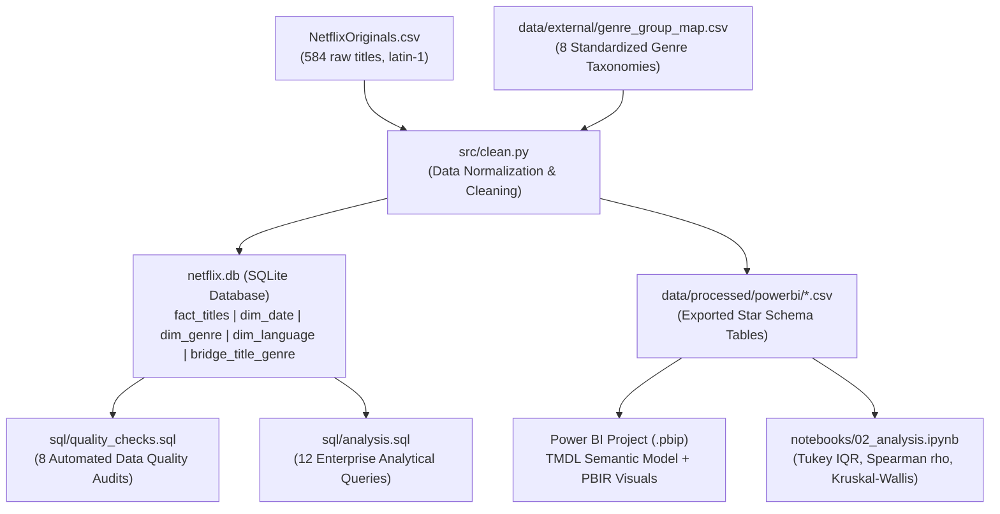
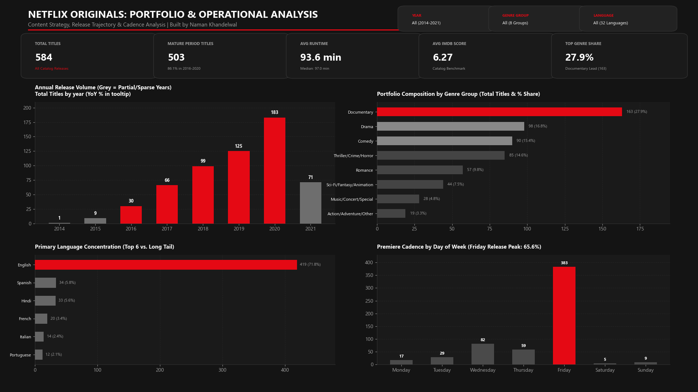
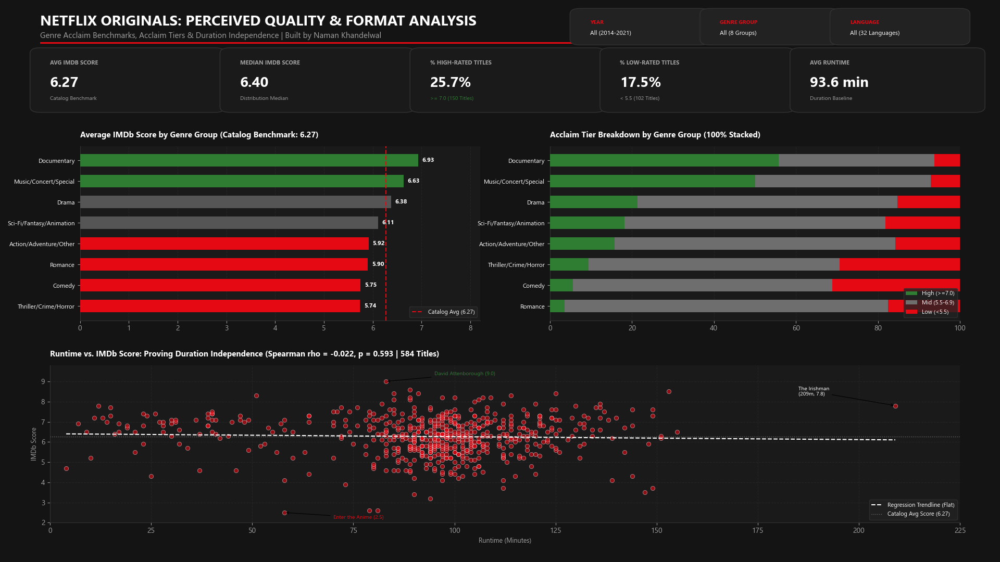
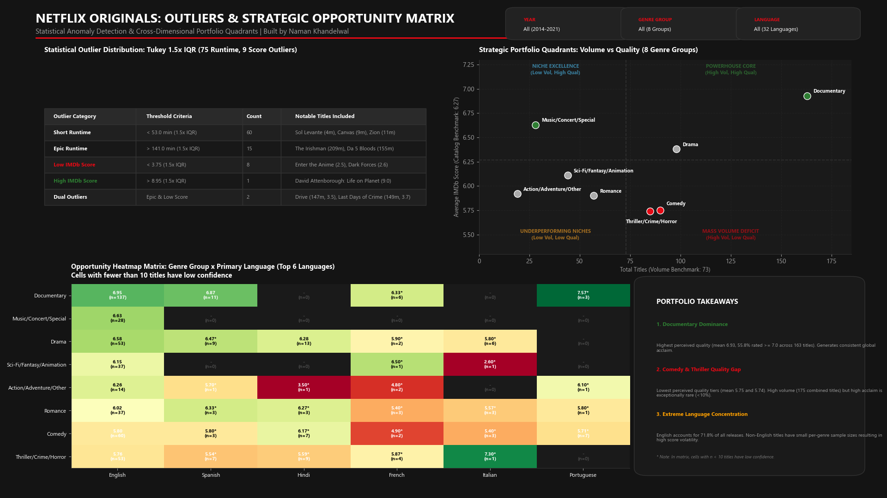

# Netflix Originals Analytics: Content Strategy & Quality Benchmarks (SQL + Python + Power BI)

**An End-to-End Enterprise Data Analytics & Business Intelligence Project**  
**Author:** [Naman Khandelwal](https://github.com/namankhandelwal1607)  

[](#4-database--star-schema-architecture)
[](#5-statistical-methodology--hypothesis-testing)
[](#3-interactive-power-bi-dashboards)
[](#power-bi-report-structure)
[](LICENSE)

---

## 1. Executive Summary & Business Problem

In the modern streaming landscape, content acquisition and original film production demand a delicate balance between **portfolio scaling**, **genre diversification**, and **perceived quality**. This project delivers an end-to-end, enterprise-grade business intelligence and analytics suite evaluating the content strategy and catalog performance of **584 Netflix Original films** released globally between December 2014 and May 2021.

### Core Business Questions Addressed
1. **Portfolio Mix & Scaling:** How did Netflix scale its original film slate across full reporting years (2016–2020)? How concentrated is the catalog in primary genres and languages, and what operational cadence governs premiere scheduling?
2. **Perceived Quality Benchmarks:** Which genre groups and languages consistently lead or lag in IMDb rating ($n \ge 10$)? What proportion of titles achieve critical acclaim ($\ge 7.0$)? Does longer runtime correlate with higher perceived quality?
3. **Outliers & Strategic Matrix:** Which titles represent statistical anomalies in duration and rating? When cross-tabulating genres against top primary languages, which intersections represent defensible strongholds versus high-risk or underperforming gaps?

---

## 2. Project Architecture & Data Pipeline



The system operates across three tightly integrated layers:
- **Data Engineering:** Automated ingestion, cleaning, date dimension expansion, multi-genre atomization, and 5-table star schema generation.
- **Analytical & Statistical Engine:** 12 complex SQL business queries (CTEs, window functions) paired with rigorous non-parametric statistical hypothesis testing (Spearman rank correlation, Kruskal-Wallis $H$-test).
- **Business Intelligence & Presentation:** An enterprise 3-page interactive Power BI report built using modern Power BI Project (`.pbip`) format with Tabular Model Definition Language (TMDL) and native DAX measures.

---

## 3. Interactive Power BI Dashboards

The Power BI project (`powerbi/netflix_report/processedData.pbip`) features a bespoke **Netflix Dark Theme** (`#141414` canvas, `#1A1A1A` cards, `#E50914` signature red accents), designed across 3 synchronized pages.

### Page 1: Portfolio Overview & Release Dynamics
Evaluates catalog growth, genre composition, language distribution, and premiere operational cadence.



- **Executive KPI Row:** 584 Total Titles, 503 Mature Period Releases (86.1%), 93.6 min Average Runtime, 6.27 Catalog Benchmark Score, 27.9% Top Genre Share.
- **Annual Trajectory:** Distinguishes full reporting years (2016–2020) from testing/partial years (2014, 2015, 2021). Release volume scaled from 30 titles in 2016 to 183 in 2020 (+510%).
- **Operational Premiere Cadence:** Identifies an intentional release strategy where **65.6% of all originals (383 titles)** premiere on Fridays to capture peak weekend streaming traffic.

---

### Page 2: Perceived Quality & Format Analysis
Deep-dives into genre rating distributions, quality tiers, and duration correlations.



- **Genre Rating Benchmarks:** Documentaries achieve the highest average score (**6.93**), followed by Music/Specials (**6.63**) and Drama (**6.38**), all surpassing the catalog benchmark (**6.27**). Comedy (**5.75**) and Thriller/Crime/Horror (**5.74**) lag significantly.
- **100% Stacked Acclaim Tiers:** Documentaries lead with **55.8%** of titles achieving high acclaim ($\ge 7.0$), whereas only **5.6%** of Comedies and **9.4%** of Thrillers reach this tier. Over 31% of Comedies fall below 5.5.
- **Duration Independence:** Scatter plot of all 584 titles proves duration has **zero correlation with perceived quality** ($\rho = -0.022, p = 0.593$).

---

### Page 3: Outliers & Strategic Opportunity Matrix
Identifies catalog anomalies and provides cross-dimensional strategic guidance.



- **Tukey $1.5 \times \text{IQR}$ Outliers:** Explores 75 duration anomalies (60 shorts < 53 min and 15 epic features > 141 min such as *The Irishman* at 209 min) and 9 score anomalies (8 underperformers < 3.75 and 1 high-score standout: *David Attenborough: A Life on Our Planet* at 9.0).
- **Strategic Portfolio Quadrants:** Maps Volume (X) vs. Quality (Y), classifying Documentaries as the primary "Powerhouse Core" and Comedy/Thriller as "Mass Volume Deficits".
- **Opportunity Heatmap Matrix:** Cross-tabulates all 8 genre groups against the top 6 languages (English, Spanish, Hindi, French, Italian, Portuguese) with cell confidence warnings for sample sizes $n < 10$.
- **Portfolio Takeaways Card:** Highlights Documentary dominance, Comedy/Thriller quality gaps, and heavy English language concentration (71.8%).

---

## 4. Database & Star Schema Architecture

The relational schema is implemented in SQLite (`netflix.db`) and exported as star-schema tables for Power BI:

```
                  ┌──────────────────────────────┐
                  │           dim_date           │
                  ├──────────────────────────────┤
                  │ date_key (PK)                │
                  │ full_date                    │
                  │ year, quarter, month_name... │
                  │ is_full_year, is_weekend     │
                  └──────────────┬───────────────┘
                                 │ 1:N
                                 ▼
┌─────────────────────────┐    ┌─────────────────────────────────┐    ┌──────────────────────────┐
│       dim_language      │    │           fact_titles           │    │         dim_genre        │
├─────────────────────────┤    ├─────────────────────────────────┤    ├──────────────────────────┤
│ language_id (PK)        ├───►│ title_id (PK)                   │    │ genre_id (PK)            │
│ language_name           │    │ title                           │    │ genre_name               │
└─────────────────────────┘    │ date_key (FK)                   │    └─────────────┬────────────┘
                               │ primary_genre_id                │                  │
                               │ primary_genre_name              │                  │
                               │ genre_group                     │                  │ 1:N
                               │ primary_language_id (FK)        │                  ▼
                               │ primary_language                │    ┌──────────────────────────┐
                               │ runtime, runtime_bucket         │    │    bridge_title_genre    │
                               │ imdb_score, score_bucket        │    ├──────────────────────────┤
                               │ runtime_outlier, score_outlier  │    │ title_id (FK)            │
                               │ is_outlier, outlier_type        │◄───┤ genre_id (FK)            │
                               └─────────────────────────────────┘    └──────────────────────────┘
```

- **`fact_titles` (584 rows):** Central fact table containing core title metrics, standardized genre groups, surrogate keys, and precomputed Tukey outlier classifications.
- **`dim_date` (387 rows):** Calendar dimension detailing year, quarter, month number/name, day of week, weekend flags, and mature full-year indicators (`is_full_year = 1` for 2016–2020).
- **`dim_genre` (91 rows) & `bridge_title_genre` (643 rows):** Handles multi-genre titles (51 titles with compound tags) through a normalized bridge table, allowing atomic genre filtering without double-counting catalog totals.
- **`dim_language` (32 rows):** Standardized dimension of all spoken primary languages.

---

## 5. Verified Data Audit & Benchmarks

The following audited figures represent verified calculations across the complete 584-title catalog:

### Genre Group Quality & Volume Breakdown
| Genre Group | Title Count | % of Catalog | Mean IMDb Score | Median IMDb | % High-Rated ($\ge 7.0$) | % Low-Rated ($< 5.5$) |
| :--- | :---: | :---: | :---: | :---: | :---: | :---: |
| **Documentary** | 163 | 27.91% | **6.93** | 7.00 | **55.83%** | 6.13% |
| **Drama** | 98 | 16.78% | **6.38** | 6.40 | **21.43%** | 15.31% |
| **Comedy** | 90 | 15.41% | **5.75** | 6.00 | **5.56%** | **31.11%** |
| **Thriller/Crime/Horror** | 85 | 14.55% | **5.74** | 5.80 | **9.41%** | **29.41%** |
| **Romance** | 57 | 9.76% | **5.90** | 6.00 | **3.51%** | 17.54% |
| **Sci-Fi/Fantasy/Animation** | 44 | 7.53% | **6.11** | 6.25 | **18.18%** | 18.18% |
| **Music/Concert/Special** | 28 | 4.79% | **6.63** | 6.65 | **50.00%** | 7.14% |
| **Action/Adventure/Other** | 19 | 3.25% | **5.92** | 6.00 | **15.79%** | 15.79% |
| **Catalog Total / Overall** | **584** | **100.0%** | **6.27** | **6.40** | **25.68%** | **17.47%** |

### Concentration Metrics
- **Top 3 Genres Combined Share** (Documentary, Drama, Comedy): **60.10%** (351 of 584 titles).
- **Top 3 Languages Combined Share** (English: 419, Spanish: 34, Hindi: 33): **83.22%** (486 of 584 titles).

### Statistical Outlier Audit (Tukey $1.5 \times \text{IQR}$)
- **Short Duration (< 53 min):** 60 titles (primarily short films and animation specials, e.g., *Sol Levante* at 4m, *Canvas* at 9m, *Zion* at 11m).
- **Epic Duration (> 141 min):** 15 titles (*The Irishman* at 209m, *Da 5 Bloods* at 155m, *Springsteen on Broadway* at 153m, *Citation* at 151m, *The Forest of Love* at 151m, *The Last Days of American Crime* at 149m, *Raat Akeli Hai* at 149m, *Ludo* at 149m, *Army of the Dead* at 148m, *Drive* at 147m, *Ghost Stories* at 144m, *22 July* at 144m, *Rolling Thunder Revue* at 144m, *Ride or Die* at 142m, *Ajeeb Daastaans* at 142m).
- **Low IMDb Score (< 3.75):** 8 titles (*Enter the Anime* at 2.5, *Dark Forces* at 2.6, *The App* at 2.6, *The Open House* at 3.2, *Kaali Khuhi* at 3.4, *Drive* at 3.5, *Leyla Everlasting* at 3.7, *The Last Days of American Crime* at 3.7).
- **High IMDb Score (> 8.95):** 1 title (*David Attenborough: A Life on Our Planet* at 9.0).
- **Dual Outliers (Both Epic Runtime & Low Score):** *Drive* (147m, 3.5) and *The Last Days of American Crime* (149m, 3.7).

---

## 6. Statistical Methodology & Hypothesis Testing

All statistical calculations were executed in Python (`scipy.stats`, `statsmodels`) and verified via SQL parity tests in `notebooks/02_analysis.ipynb`:

1. **Duration vs. Score Independence:**
   - Spearman rank correlation coefficient: **$\rho = -0.0221$** ($p = 0.593$).
   - Because $p > 0.05$, we fail to reject the null hypothesis of independence. Runtime has no statistically significant relationship with perceived viewer satisfaction.
2. **Genre Quality Disparity:**
   - Kruskal-Wallis non-parametric ANOVA on IMDb score across the 8 genre groups: **$H = 168.87$** ($p = 7.7 \times 10^{-33}$).
   - The extreme test statistic confirms that differences in perceived quality across genre categories are highly statistically significant.

---

## 7. Key DAX Measures (Sample)

All DAX logic is modularized and formatted in [`powerbi/measures.dax`](powerbi/measures.dax):

```dax
// Acclaim Share: Proportion of titles with IMDb score >= 7.0
% High-Rated Titles = 
VAR HighRatedCount = CALCULATE([Total Titles], fact_titles[imdb_score] >= 7.0)
VAR OverallTitles = [Total Titles]
RETURN
    DIVIDE(HighRatedCount, OverallTitles, 0)

// Year-over-Year Title Growth % (Restricted to mature full reporting years)
Titles YoY Growth % = 
VAR CurrentYear = SELECTEDVALUE(dim_date[year])
VAR IsCurrentFull = SELECTEDVALUE(dim_date[is_full_year])
VAR CurrentReleases = [Total Titles]
VAR PriorYearReleases = 
    CALCULATE(
        [Total Titles],
        FILTER(ALL(dim_date), dim_date[year] = CurrentYear - 1 && dim_date[is_full_year] = 1)
    )
RETURN
    IF(
        IsCurrentFull = 1 && NOT ISBLANK(PriorYearReleases) && PriorYearReleases > 0,
        DIVIDE(CurrentReleases - PriorYearReleases, PriorYearReleases, BLANK()),
        BLANK()
    )

// Dynamic Sample Reliability Flag
Sample Reliability Badge = 
VAR TitleCount = [Total Titles]
RETURN
    IF(
        TitleCount < 10,
        "⚠️ Low Sample (n < 10) - High Variance",
        "✅ Robust Sample (n >= 10)"
    )
```

---

## 8. Repository Structure

```
NetflixAnalysis/
├── README.md                                  <- Executive project portfolio presentation
├── data_quality_log.md                        <- Data defects audit & pipeline corrective log
├── resume_bullets.md                          <- Quantified resume impact statements
├── interview_prep.md                          <- 10 technical & strategic interview Q&As
├── NetflixOriginals.csv                       <- Working dataset copy (584 rows, latin-1)
├── netflix.db                                 <- Production SQLite database (5 tables)
├── data/
│   ├── external/
│   │   └── genre_group_map.csv                <- Explicit mapping of 115 raw genres to 8 groups
│   └── processed/powerbi/                     <- Star schema CSVs exported for Power BI
│       ├── fact_titles.csv                    <- Central fact table (584 titles)
│       ├── dim_date.csv                       <- Date dimension table (387 dates)
│       ├── dim_genre.csv                      <- Atomic genre dimension (91 genres)
│       ├── dim_language.csv                   <- Language dimension (32 languages)
│       └── bridge_title_genre.csv             <- Normalized bridge table (643 pairs)
├── powerbi/
│   ├── netflix_report/                        <- Active Power BI Project (.pbip)
│   │   ├── processedData.pbip                 <- Master project launcher
│   │   ├── processedData.Report/              <- PBIR report & visual definitions (3 pages)
│   │   └── processedData.SemanticModel/       <- TMDL semantic model definition
│   ├── data_model.md                          <- Schema relationship & bridge documentation
│   ├── dashboard_spec.md                      <- Visual design & wireframe specifications
│   ├── build_steps.md                         <- Step-by-step build & verification guide
│   └── measures.dax                           <- Complete DAX measure library
├── reports/
│   ├── executive_summary.md                   <- 1-page executive memo (SCA framework)
│   └── screenshots/                           <- High-resolution dashboard screenshots
│       ├── page1_portfolio_overview.png
│       ├── page2_quality_analysis.png
│       └── page3_outliers_opportunities.png
├── sql/
│   ├── quality_checks.sql                     <- 8 automated referential integrity queries
│   └── analysis.sql                           <- 12 enterprise analytical business queries
├── src/
│   ├── clean.py                               <- End-to-end data cleaning & star schema pipeline
│   ├── validate_tmdl.py                       <- TMDL semantic model structure validator
│   ├── validate_pbir.py                       <- PBIR schema & field validator
│   └── generate_dashboard_screenshots.py      <- Dashboard screenshot rendering script
└── notebooks/
    ├── 01_cleaning.ipynb                      <- Interactive pipeline walkthrough
    └── 02_analysis.ipynb                      <- Statistical hypothesis testing & SQL parity
```

---

## 9. How to Run and Reproduce

### 1. Prerequisites
- Python 3.10+
- SQLite3 (standard library)
- Power BI Desktop (August 2026 / Version 2.157+ recommended for PBIP support)

### 2. Environment Setup
```bash
# Clone the repository
git clone https://github.com/namankhandelwal1607/NetflixAnalysis.git
cd NetflixAnalysis

# Install dependencies
pip install pandas numpy matplotlib seaborn scipy
```

### 3. Rebuild Database & Pipeline
```bash
python src/clean.py
```
*Generates `netflix.db` and exports the 5 star-schema CSVs into `data/processed/powerbi/`.*

### 4. Run Automated SQL Data Quality Suite
```bash
python -c "import sqlite3; conn = sqlite3.connect('netflix.db'); cur = conn.cursor(); sql = open('sql/quality_checks.sql').read(); [print(cur.execute(q).fetchall()) for q in sql.split(';') if q.strip()]"
```
*All 8 referential integrity and boundary audits execute with 100% pass.*

### 5. Validate Power BI Project (TMDL & PBIR)
```bash
python src/validate_tmdl.py
python src/validate_pbir.py
```
*Validates that 0 duplicate table definitions exist in TMDL and all PBIR visual field references are resolved.*

### 6. Open the Power BI Report
Open `powerbi/netflix_report/processedData.pbip` directly in Power BI Desktop to explore all 3 pages, DAX measures, and interactive slicers.

---

## 10. Critical Business Boundaries & Limitations

> [!IMPORTANT]
> **Data Governance Boundaries:**
> 1. **No Audience Viewership Figures:** The dataset contains no streaming hours, completion rates, or subscriber counts. High IMDb ratings reflect critical/viewer sentiment among self-selected reviewers, not platform popularity or subscriber retention.
> 2. **No Financial or Production Costs:** Production budgets and marketing spend are absent. Return on Investment (ROI) and cost-per-minute cannot be calculated from this dataset.
> 3. **Reviewer Self-Selection Bias:** IMDb raters are voluntary. Documentaries often attract enthusiastic, dedicated reviewers (driving higher mean scores), whereas mass-market comedies attract casual, hyper-critical ratings.
> 4. **Small-Sample Volatility:** 26 of 32 languages and 108 of 115 raw genres have fewer than 10 titles ($n < 10$). Conclusions drawn from these sparse slices have high variance.
> 5. **Temporal Censoring:** 2021 contains only 5 months of releases (through May 27, 2021), and 2014–2015 represent initial testing slates. All annual growth assessments must be isolated to 2016–2020.
